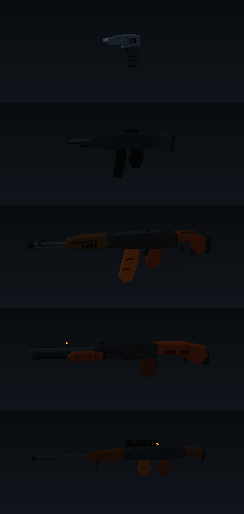
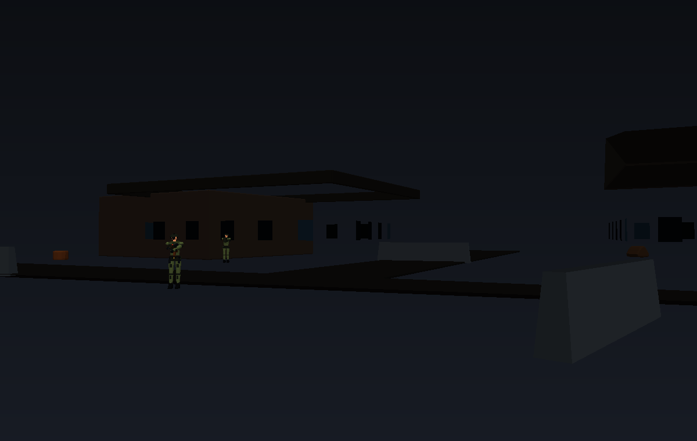
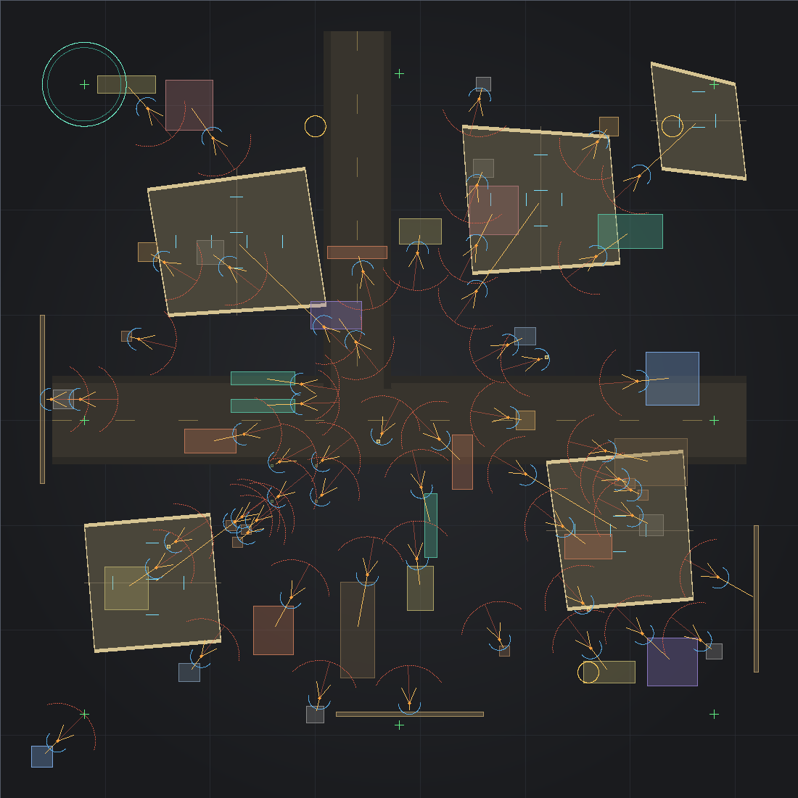
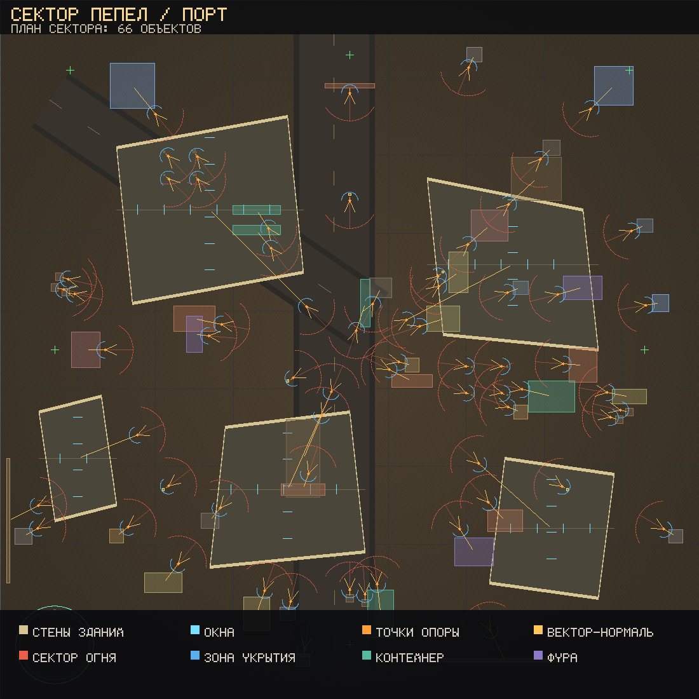

# СЕКТОР «ПЕПЕЛ» — тактический шутер с 1760 анимациями

Браузерный шутер от первого лица на Three.js. Все модели, оружие, уровни, звук и
анимации собраны с нуля: ни одного внешнего ассета, ни одного CDN-запроса.
Работает офлайн прямо из папки — достаточно открыть `index.html`.

Модели построены по **обведённым точками контурам**: силуэт детали обводится
точками, и по ним выдавливается объём с фаской (оружие), строится лофт по
сечениям (тело) или тело вращения (шлем, стволы, бочки). Карты — полигоны
зданий, вышек и укрытий, а не набор кубов. Подробнее: [«Геометрия»](#-геометрия-контур-точками--объёмная-модель).

▶️ **Играть:** [`shooter-2/index.html`](./index.html)

---

## ⭐ Главное: анимации

Требование «у каждой части тела минимум 15 анимаций, у каждой анимации 4 варианта»
выполнено с запасом:

| | Количество |
|---|---|
| Частей тела | **22** |
| Анимаций на каждую часть | **20** (нужно было 15) |
| Вариантов каждой анимации | **4** |
| Клипов на часть | **80** |
| **Всего клипов** | **1760** |

**22 части:** таз, поясница, грудная клетка, шея, голова, две ключицы, два плеча,
два предплечья, две кисти, два тазобедренных сустава, два бедра, два колена,
две стопы, оружие.

**20 анимаций:** стойка, дыхание, шаг вперёд, шаг назад, шаг влево, шаг вправо, бег,
присед, прицеливание, выстрел, перезарядка, прыжок, падение, приземление, ранение,
смерть, ближний бой, бросок гранаты, жест/команда, осмотр оружия.

**4 варианта:** стандарт, агрессивный, осмотрительный, раненый. Вариант меняет
амплитуду, темп, асимметрию, наклон корпуса, хромоту и добавляет детерминированный
джиттер — «раненый» действительно хромает и валится на сторону.

### Как это устроено

Анимация — не случайный шум, а смысловые каналы: наклон корпуса, взмах ноги,
сгиб колена, подъём руки, отдача, поворот головы. Каждый клип раскладывает эти
каналы по костям с индивидуальными весами (`SRC/data.js → SIGNALS`, `mapRole`).
Дальше:

* **слои** — ноги играют `run`, руки и оружие одновременно играют `aim`
  (`SRC/anim.js → Animator`);
* **сглаживание** — ключевые кадры интерполируются по smoothstep, позы доводятся
  экспоненциальным сглаживанием, поэтому переходы не «щёлкают»;
* **кэш** — кривая пары (часть, клип, вариант) строится один раз;
* **IK-хват** — оружие закреплено на груди, а кисти аналитическим two-bone IK
  дотягиваются до рукояти и цевья (`SRC/ik.js`). Поэтому ствол всегда смотрит
  вперёд, даже когда корпус наклоняется в беге;
* **автоподстройка по земле** — после позы стопы «ставятся» на пол, и ни одна
  из 1760 поз не проваливается сквозь землю;
* **лаборатория** — прямо в игре можно выбрать любую из 22 частей, любую из
  20 анимаций и любой из 4 вариантов и посмотреть клип вживую.

Для каждой части тела используется своя пара независимых настроек рук
(`ARM_POSE`), а поканальные сигналы `armSwingL/armSwingR`, `armBendL/armBendR`
позволяют правой руке держать рукоять, а левой — цевьё.


---

## 📐 Геометрия: контур точками → объёмная модель

Модели не собираются из кубов. Каждая деталь сначала **обводится точками** — как
трассировка по референсу, — и только потом из контура рождается объём.

Три инструмента (`src/outline.js`):

| Инструмент | Что делает | Где применяется |
|---|---|---|
| `outlineMesh(pts, {depth, bevel, taper})` | выдавливание обведённого силуэта с фаской и переменной толщиной | ствольная коробка, магазин, ложа, приклад, бронеплита, подсумки, ботинок |
| `loftSections(sections)` | лофт по сечениям-суперэллипсам вдоль оси | торс, бёдра, голени, плечи, предплечья, кулаки |
| `revolve(pts, {segments})` | тело вращения по профилю | шлем, череп, наушники, стволы, пламегаситель, оптика, бочки, мешки |

Дополнительно: `smoothOutline()` сглаживает обводку сплайном Catmull-Rom,
`vehicleBody()` строит кузов по боковому контуру.

### Оружие — по чертежам (`src/gunblueprints.js`)

Пятнадцать стволов описаны как наборы обведённых контуров: ствольная коробка,
цевьё, магазин, рукоять, приклад, газовая трубка, прицельные приспособления,
спусковая скоба, антабка. Дальше `buildFromBlueprint(id)` выдавливает контуры
в объём.

Силуэт отличает оружие друг от друга — не цвет, а форма:

| Класс | Стволы | Чем отличаются на экране |
|---|---|---|
| короткие | ПМ-9 «Оса», Р-6 «Клык», МП-28 «Шершень» | барабан и курок револьвера, магазин-рукоять и «ушки» целика у МП |
| пистолеты-пулемёты | КП-45 «Стриж», ПДВ «Стриж-2» | чемодан-корпус и складной приклад, прорези в цевье |
| автоматы | АК «Гроза», К-16 «Куница», БП-9 «Сова» | планка и кольца под оптику, магазин в прикладе у булл-папа |
| поддержка | ПКМ «Молотило» | кожух с вентиляцией, сошки, короб с лентой, ручка переноски |
| дробовики | ТОЗ «Дробь», ТОЗ-24 «Буран» | трубка магазина, коллиматор, патроны на цевье |
| точный огонь | СВД «Игла», СВ-12 «Карандаш» | большая оптика с барабанчиком поправок, вырез в прикладе |
| тяжёлое | РГ-7 «Кувалда», РС-1 «Игломёт» | труба с гранатой в канале, три рельса и катушки с голубыми вставками |

Игрок получает их по миссиям (`loadout`), боевики — по типу: стрелок с СВ-12,
тяжёлый с «Бураном», разведчик с «Шершнем», командир с «Куницей», босс с
«Молотилом».



### Солдат — по сечениям и контурам (`src/soldier.js`)

* **торс и жилет** — лофт из семи сечений: талия уже, грудь шире, плечи с фаской;
* **голова** — череп телом вращения, визор и дыхательная маска отдельными контурами,
  каска — купол вращения с козырьком-контуром и наушниками;
* **руки и ноги** — лофт вдоль кости с сужением к локтю и колену, накладки и
  наколенники — контуры с фаской;
* **ботинок** — боковой силуэт, выдавленный на ширину стопы, плюс подошва и голенище;
* **снаряжение** — рюкзак с клапаном, стяжками и скаткой, плечевые стропы,
  рация с антенной на плече, нож в набедренном чехле, шейный платок, ремешки на
  предплечье, колене и голени, шнуровка ботинок, крепление ПНВ и подбородочный
  ремень каски;
* **рюкзак, подсумки, пряжка, фляга** — отдельные контуры и тела вращения.


### Карта — полигоны, а не кубы (`src/level.js`)

* **здания** — произвольный многоугольник в плане, выдавливается на высоту;
  крыша двускатная (лофт от свеса к коньку) или плоская с парапетом по контуру;
  окна расставляются по фасадам с учётом нормали;
* **вышки** — четыре наклонные опоры, раскосы, площадка и перила;
* **укрытия** — бетонные блоки со скошенными гранями и жёлтой полосой,
  мешки по линии обороны, бочки, камни по обводке, штабели труб;
* **мешки** — кладка вперевязку: суперэллиптическая подушка (а не «пилюля»),
  длинная ось вдоль стены, каждый ряд короче на один мешок, второй тон и
  микро-разворот, поэтому стена читается ровной, без клиньев и дыр на стыках;
* **граница сектора** — по периметру карты стоит ограждение: бордюр, сетка с
  прутьями до 2 м, столбы, две нити колючей проволоки с шипами, ворота с аркой,
  табличкой и поднятым шлагбаумом. Сетка простреливается (коллайдер
  `standLow`, высота 1.05 м) — край карты стал границей объекта, а не обрывом;
* **дорога** — полосы из полигонов с обочиной и осевой разметкой;
* **техника и грузы** — морские контейнеры с рёбрами жёсткости и торцевыми
  дверями, крытые фуры (кабина со скосом лобового, тент-лофт, колёса-вращения);
* **оборудование** — фонари (столб + кронштейн + плафон), наблюдательные вышки
  (четыре опоры, раскосы, площадка с перилами, скат), пулемётные гнёзда
  (кольцо мешков, станок, ствол), маскировочные сети на стойках;
* **детализация фасадов** — цоколь, карниз и угловые накладки, подоконники,
  водосточная труба, блок вентиляции, дверь со ступенькой и ручкой; у скатных
  крыш — кровельные швы, которые режут свет на полосы;
* **детализация пропсов** — у контейнеров маркировка, замки-засовы и поручни,
  у грузовика фары, решётка, бампер, зеркала и дуги тента, у фонаря основание и
  шкафчик с автоматом, у вышки лестница с перекладинами и доски настила;
* **следы боя** — воронки (кольца выброса, дно, комья), кучи обломков, горки
  гильз, подбитая техника с катками и отвалом башни, заборы, траншеи.
* коллизии выводятся из тех же полигонов автоматически: один AABB на здание,
  ориентированный блок — на баррикаду, круг — на бочку.

Дополнительно у каждого препятствия есть:

| Данные | Зачем |
|---|---|
| `holes` — проёмы по высоте | пуля и линия видимости проходят в окно, но не в фундамент |
| `standLow` — низкое препятствие | мешки и камни держат стоящего, но не прыгнувшего (Space) |
| `anchor`, `normalX/Z` — точка опоры и нормаль | ИИ встаёт за укрытие именно отсюда |
| `coverHeight` — 1/2/3 класс высоты | присед превращает низкое укрытие в полное |



### План карты: точки, векторы, углы

`tools/preview.mjs --plan <id>` рисует схему сверху тем же кодом, что строит
уровень, — это не картинка, а данные игры:



* **жёлто-бежевый контур** — стены зданий, толстая линия — толщина стены;
* **голубые штрихи** — окна-проёмы (в них видят и стреляют);
* **оранжевая точка + стрелка** — точка опоры и наружная нормаль препятствия;
* **красная дуга** — сектор обстрела из этой точки (120°);
* **синяя дуга у стены** — зона укрытия с противоположной от нормали стороны;
* **цвет прямоугольника** — тип коллайдера: контейнер бирюзовый, фура фиолетовая,
  мешки песочные, техника красноватая, вышка голубая, забор коричневый;
* **зелёные кресты** — точки появления, **бирюзовое кольцо** — эвакуация,
  **жёлтые кольца** — ящики с припасами.

Три карты в рисованном варианте (`--art`): тёплая земля, заголовок и легенда
рисуются тем же кодом, без внешних шрифтов и картинок.

| Карта | Объектов | Коллайдеров | Точки опоры | Схема |
|---|---|---|---|---|
| Склады | 68 | 57 | 57 | `docs/plan-depot-art.png` |
| Караван | 53 | 45 | 45 | `docs/plan-convoy-art.png` |
| Порт | 73 | 66 | 66 | `docs/plan-harbor-art.png` |



### Оружие отлетает от убитых

При смерти бойца ствол отделяется от куклы и летит отдельным телом: падает,
вращается, ударяется об пол и засыпает (`Ragdoll.detachWeapon/stepWeapon`).
Одновременно на карте не больше шести летящих стволов — бюджет на draw calls.

---

## 🤖 Боевики, которым «больно думать»

Каждый боец думает не каждый кадр, а **тиками**: `thinkTime` растёт с каждой
мыслью подряд (усталость от размышлений), а `thinkQuality` заставляет ошибаться.
На каждом тике он оценивает восемь вариантов поведения:

`advance` · `hold` · `cover` · `flank` · `suppress` · `retreat` · `grenade` · `melee`

Счёт каждого варианта складывается из дистанции до игрока, здоровья, наличия
укрытия, линии огня, агрессии, приказа командира и собственного качества
мышления. Реакция на игрока — не мгновенная: сначала `reaction`-задержка,
потом прицеливание, потом очередь. Чем хуже боец думает, тем позже он
реагирует и тем больше мажет — поэтому «больно думать» это буквально механика,
а не украшение.

Ещё в ИИ:

* **укрытия** — сканирование окружения по 12 направлениям с проверкой,
  закрывает ли препятствие линию от угрозы;
* **фланги** — обход с выбором стороны и точки за спиной игрока;
* **подавление** — огонь по последней известной позиции, когда цель скрылась;
* **память** — последняя позиция игрока живёт 8 секунд, потом боец идёт искать;
* **приказы** — командир и «Архитектор» раздают приказы в радиусе 26 м, и
  строй действительно меняет поведение;
* **мысли на экране** — над головами всплывают «Считаю углы…», «Надо обойти
  слева» (клавиша `T`);
* **прицеливание бойца** — ствол не прилипает к игроку: он догоняет цель
  пружиной с конечной скоростью (зависит от меткости), «дышит» синусоидальным
  шумом, получает подброс от собственной отдачи и срывается, если ушёл слишком
  далеко. Стрелять боец начинает только когда прицел устоялся (`aimSettle`),
  а умные берут упреждение по скорости игрока.

Шесть типов: боец, разведчик, стрелок, тяжёлый, командир и босс «Архитектор».

---

## 🕸 Кукла из точек (Verlet ragdoll)

При смерти боец не проигрывает анимацию падения, а превращается в физическую
куклу: **17 точек, 23 связи**, импульс от попавшей пули, столкновения со
стенами и ящиками, трение о пол.

Оптимизация регдола, которая **не ухудшает видимую картинку**:

1. **Адаптивные подшаги** — один крупный шаг, пока кукла в воздухе; два мелких,
   когда точка касается пола (именно там нужна точность).
2. **Сон** — когда все точки успокоились, симуляция выключается полностью.
3. **Затухание и трение** — кукла не «дрожит» вечно от коррекций связей.
4. **Отсев** — столкновения только с ближайшими AABB по 2D-сетке.
5. **Тени и кости** — на спящей кукле не пересчитываются матрицы.

---

## ⚡ Оптимизация без потери видимой графики

| Приём | Что делает |
|---|---|
| Склейка статики по материалу | сотни стен, ящиков и баррикад → 2–4 draw call на уровень |
| LOD бойцов | дальше 26 м без теней, анимация каждый 2–3 кадр, без IK |
| `matrixAutoUpdate = false` для деталей | десятки лишних матриц в кадр не считаются |
| Пулы частиц и пуль | 240 частиц = один InstancedMesh, а не 240 объектов |
| Адаптивное разрешение | держит 60 FPS, но не опускается ниже 0,75 от окна |
| Теневые бюджеты | размер карты теней по пресету качества, а не «на глаз» |
| Кэш кривых анимаций | 1760 клипов не пересчитываются в кадре |
| Лимит трупов | дальние куклы убираются, чтобы не копить draw call |
| Бюджет голосов звука | не больше 26 одновременных синтезированных звуков |

Панель счётчиков (`F`) показывает FPS, draw calls, треугольники, LOD-разбивку,
шаги регдола, число частиц, сколько статики склеено и сколько кривых в кэше.
Лаборатория анимаций и игровая графика используют один и тот же риг, поэтому
оптимизации проверяются на глаз, а не на веру.

---

## 🎮 Миссии

| # | Название | Тип | Особенность |
|---|---|---|---|
| 1 | Пепел на складах | зачистка | первое столкновение, ящики держат пули |
| 2 | Тихий этаж | зачистка | снайпер простреливает двор |
| 3 | Караван | диверсия | три ящика с взрывчаткой под охраной |
| 4 | Держать коридор | оборона | 90 секунд, три волны, кончаются патроны |
| 5 | Порт | эвакуация | прорыв через порт к точке эвакуации |
| 6 | Архитектор | босс | командир, который думает быстрее всех |

Оружие (собственные модели и ТТХ): 15 стволов — от ПМ-9 «Оса» и Р-6 «Клык» до
ПКМ «Молотило», СВ-12 «Карандаш», РГ-7 «Кувалда» и рельсового РС-1 «Игломёт».
Гранаты с физикой отскока и осколками: взрыв даёт до 90 кусочков металла с
собственной физикой (отскок, трение, вращение), которые падают и остаются на
земле, а шрапнель наносит отдельный урон в 1.35 радиуса — только при прямой
видимости, поэтому через стену не задевает.

Отдача и прицеливание:

* **отдача** — пружина с демпфированием: ствол толкается назад-вверх, проскакивает
  ноль и мелко дрожит; тяжёлое оружие ведёт ровнее, лёгкое сильнее уводит в
  сторону. Накопленная отдача вкладывается в `pitch/yaw` в момент выстрела, а
  не дёргает камеру повторно в кадре;
* **прицеливание** — вход в прицел быстрее выхода, поворот мыши на прицеле
  замедлен, разброс от движения и нагрева ствола растёт вдвое медленнее;
* **инерция** — ствол отстаёт от поворота и догоняет его пружиной, на ходу
  покачивается «восьмёркой», у спринта уходит вниз;
* **перезарядка** — три фазы (достал магазин, вставил с толчком, вернул ствол),
  левая рука уходит с цевья к магазину по дуге.

## 🧭 Интерфейс

* **Мини-карта** — стены, точка эвакуации, бойцы (яркие — те, кто вас видит) и конус взгляда.
* **Подпись цели** — под прицелом видно тип, дистанцию и остаток здоровья бойца.
* **Таблица боя** (`Tab`) — убийства, попадания в голову, точность, нанесённый и полученный урон.
* **Мысли врагов** (`T`) — над головами всплывают их размышления.
* **Счётчики** (`F`) — FPS, draw calls, треугольники, LOD, шаги регдола, частицы,
  число полигональных объектов карты и коллайдеров.
* **Прогресс и рекорды** — открытые миссии и лучшие очки хранятся в браузере (localStorage).
* **Телефоны** — тач-обзор, виртуальный стик и кнопки «огонь / прицел / перезарядка / присед / бег / граната».

## ⌨️ Управление

**Телефон:** палец ложится в **левую нижнюю часть экрана** и тянется — база
стика появляется под пальцем, поэтому целиться в конкретное место не нужно.
Левая нижняя четверть экрана под стик **полностью свободна**: вспомогательные
кнопки (прицел, перезарядка, присед) подняты в верхний ряд, а прыжок и бег
стоят у правого края рядом с огнём. Раньше там стояли пять кнопок вплотную —
палец опускался на «ПРИСЕД», кнопка съедала касание, и боец не двигался.
Плавающий виртуальный стик — база появляется под пальцем, мёртвая
зона 12%, аналоговая отдача по наклону (слегка сдвинул — идёшь медленно, до
упора — бежишь, глубокий наклон сам включает спринт), плавный возврат при
отпускании. Обзор — правая половина экрана, чувствительность ниже на цели.

`B` — бот-диагност (Ctrl+B — сразу прогон) ·
`WASD` — движение · `Мышь` — взгляд · `ЛКМ` — огонь · `ПКМ` — прицел ·
`Shift` — бег · `C`/`Ctrl` — присед · `Space` — прыжок (через мешки и камни) ·
`R` — перезарядка · `1` `2` `3`/`Q` — оружие ·
`G` — граната · `P`/`Esc` — пауза · `T` — мысли врагов · `F` — счётчики ·
`Tab` — таблица · `H` — помощь.

---

## 🧪 Тесты

```bash
node shooter-2/tests/smoke.mjs     # структура, офлайн, каталог сайта
node shooter-2/tests/logic.mjs     # 1760 клипов, мир, ИИ, регдол, миссии
node shooter-2/tests/headless.mjs  # прогон настоящего игрового цикла без браузера
node shooter-2/tools/bugbot.mjs    # бот-искатель багов: таблица кодов 000–999
node shooter-2/tools/preview.mjs   # software-рендер поз в docs/*.png
```

### 🛠 Бот-диагност прямо в игре

В самой игре живёт бот: клавиша **B** (или кнопка 🛠 в правом верхнем углу HUD)
открывает панель с таблицей кодов 000–999. Внутри:

* **поле кода** — вводите `421` и видите категорию и название проверки, а если
  она падала в этом прогоне — то и что именно бот нашёл;
* **ПРОВЕРИТЬ** — прогон всех 80+ проверок по живой игре (модель, карта, ИИ,
  бой, интерфейс, устойчивость). Прогон идёт порциями по кадрам и не роняет
  fps; в конце сводка «проверок: N · проблем: M · прогон X мс»;
* **список находок** — код, категория и текст: `420 · Игрок и управление ·
  клавиши движения нажаты, а игрок стоит на месте`;
* **скопировать / сохранить .md** — отчёт уходит в буфер или файлом.

Плюс пассивный режим: бот не ждёт нажатия кнопки. Если во время боя игрок жмёт
вперёд, а тело не двигается (это и был баг «почему я ходить не могу?»), в бою
появляется тост с кодом 420/421, а запись падает в панель. Он же ловит
исключения в кадре (915), NaN (900), переполнение пулов (902), слипшихся
бойцов (609) и неисполнимые тактики (602).

```bash
# то же самое без браузера, по всему проекту:
node shooter-2/tools/bugbot.mjs
```

### 🤖 Бот-искатель багов (офлайн)

`tools/bugbot.mjs` — не «тест на 200 строк», а бот с таблицей кодов на 1000
записей (`src/bugcodes.js`, диапазоны 000–999). У каждого кода своя категория
и своя проверка: структура, данные, карты и коллизии, рендер, игрок, бой, ИИ,
анимация, интерфейс, устойчивость. Бот поднимает настоящую игру в песочнице,
гоняет 201 живой детектор по реальным подсистемам, добавляет обезьяньи прогоны
(случайные миссии, случайный ввод, случайные dt) и пишет отчёт.

```bash
node shooter-2/tools/bugbot.mjs                # полный прогон
node shooter-2/tools/bugbot.mjs --only 3xx     # только рендер и кадр
node shooter-2/tools/bugbot.mjs --seed 42      # воспроизводимый обезьяний прогон
node shooter-2/tools/bugbot.mjs --list         # напечатать таблицу кодов
```

Отчёты: `docs/bugbot-report.md` (что найдено и где искать) и
`docs/bugcodes.md` (таблица кодов с колонкой «есть ли детектор»). Код выхода
равен 1, если найдена хоть одна ошибка, — поэтому бот годится в CI.

Что бот уже поймал на этой игре:

- **фон-текстура затирала мир на втором проходе** — «небо вместо карты» после
  того, как плоский цвет неба заменили градиентом (коды 301–304). Теперь фон
  снимается на время прохода оружия и возвращается обратно;
- **тактики `peek`, `rush`, `order` у боевиков ничего не исполняли** — мозг
  выбирал тактику только из своего списка, а подсказки из данных молча
  клались в очки (код 602). Теперь все тактики из данных проходят через
  `playableTactic()` и получают поведение, а `grenade`/`melee` перестали
  означать «стоять на месте»;
- **«почему я ходить не могу?»** — вектор виртуального стика считался и
  сглаживался, но в физику тела не передавался: палец на телефоне тянул стик,
  а боец стоял. Мышь работала, поэтому баг выглядел загадочно (коды 420–425).
  Теперь `analog` доходит до `Player.update`, и это закреплено 12 проверками —
  «клавиши двигают», «стик двигает», «стик вбок не зеркалит», «отпустил —
  остановился», «движение есть на всех шести картах»;
- **две миссии нельзя было закончить** (коды 930–935). «Караван»: счётчик
  охраны брался из данных, а не из реально заспавненных бойцов, и цель
  «Зачистить охрану» требовала убить больше, чем есть на карте. «Порт»: цель
  «зачистить путь» помечена `optional`, но флаг игнорировался — пройдя мимо
  охраны к точке эвакуации, игрок оставался в миссии навсегда. Теперь бот
  каждую миссию **проходит до победы**, а не только запускает;
- **«палец в левый нижний угол» — кнопки съедали касание** (коды 434–437).
  Стик жил на канвасе, но в левой нижней четверти экрана вплотную стояли пять
  кнопок. Touch начинался на кнопке, она делала `preventDefault`, канвас
  касания не получал — со стороны это выглядело как «ходьба не работает».
  Теперь проверка строит CSS-прямоугольники всех тач-кнопок и сверяет их с
  зоной стика на трёх размерах экрана, а отдельный тест прогоняет касание из
  точки `(70, 760)` через настоящие `touchstart/touchmove` и требует, чтобы
  тело поехало.

`logic.mjs` проверяет каждую из 1760 кривых на конечность, порядок кадров и
разумную амплитуду, сравнивает варианты между собой, а также физику мира,
алгоритм укрытий, решения ИИ и приказы командира.

`headless.mjs` поднимает настоящий Three.js, подменяет только WebGL-рендерер и
DOM, запускает миссию, стреляет, убивает бойца, доводит куклу до сна,
перезапускает и проходит все шесть миссий — именно так ловятся ошибки, которых
не видит обычный unit-тест.

## 🖼 Превью моделей

`docs/` — кадры, отрисованные собственным software-рендерером
(`tools/preview.mjs`: z-buffer + ламберт, без GPU и браузера):

| Файл | Что видно |
|---|---|
| `docs/preview-poses.png` | 6 поз: стойка, шаг, бег, прицел, присед, смерть |
| `docs/preview-clips.png` | все 20 анимаций верхнего слоя, вариант «стандарт» |
| `docs/preview-variants.png` | четыре варианта ходьбы рядом |
| `docs/preview-enemies.png` | все типы боевиков и оружие |
| `docs/preview-single.png` | крупный вид модели (перезаписывается `--single`) |
| `docs/preview-guns.png` | все 15 стволов по чертежам, вид сбоку |
| `docs/preview-weapon-detail.png` | автомат и винтовка крупным планом |
| `docs/preview-props.png` | лист пропсов (`--props`): бочка, мешки, ящики, забор, фонарь, камень |
| `docs/bugcodes.md` | таблица кодов ошибок 000–999 с отметкой живых детекторов |
| `docs/bugbot-report.md` | последний отчёт бота: покрытие по категориям и находки |
| `docs/preview-map-depot.png` | карта «Склады»: здания-полигоны, вышки, укрытия |
| `docs/preview-map-harbor.png` | карта «Порт» |
| `docs/preview-fp.png` | вид от первого лица: автомат и кисти на хватах |
| `docs/preview-fp-ads.png` | прицеливание: дульный срез сведён в центр кадра |
| `docs/preview-fp-grid.png` | стволы от первого лица: короткие, автоматы, поддержка, прицел |
| `docs/preview-hands.png` | крупный план кистей и рукавов: фаланги, манжета, предплечье |
| `docs/preview-fp-portrait.png` | узкий (телефонный) экран 390×844: оружие поджато под aspect, центр кадра свободен (`--fps rifle --portrait`) |
| `docs/preview-spawn.png` | что видно на старте каждой миссии: из точки спавна открыт уровень, а не стена |
| `docs/plan-depot.png` | план «Складов»: точки опоры, нормали, сектора, окна |
| `docs/plan-*-art.png` | рисованные планы трёх карт с легендой |

```bash
node shooter-2/tools/preview.mjs            # обновить листы
node shooter-2/tools/preview.mjs --single --clip aim --yaw 0.4 --bright 2.2
node shooter-2/tools/preview.mjs --guns                       # лист оружия
node shooter-2/tools/preview.mjs --map depot --cam 6,1.7,16 --look -8,2.5,-12
node shooter-2/tools/preview.mjs --plan convoy    # схема карты с точками и углами
node shooter-2/tools/preview.mjs --fps rifle      # кадр от первого лица
node shooter-2/tools/spawnview.mjs                # стартовые кадры всех миссий
node shooter-2/tools/preview.mjs --fps rifle --ads # то же, но прицеливание
node shooter-2/tools/fpgrid.mjs docs/fp.png '[{"weapon":"pistol"},{"weapon":"rifle","ads":true}]'
node shooter-2/tools/fpgrid.mjs docs/hands.png '[{"weapon":"rifle"}]' --side   # крупный план кистей
```

## 📁 Структура

```
shooter-2/
├── index.html          интерфейс: меню, брифинг, HUD, пауза, итоги, лаборатория
├── style.css
├── three.min.js        Three.js r186 (лежит локально, офлайн)
├── src/
│   ├── data.js         22 части × 20 анимаций × 4 варианта, оружие, ИИ, миссии, карты
│   ├── outline.js      контур → объём: выдавливание, лофт, тело вращения
│   ├── gunblueprints.js чертежи 15 стволов обведёнными точками
│   ├── soldier.js      тело солдата: сечения торса, контуры головы/рук/ног
│   ├── level.js        карта из полигонов: здания, вышки, блоки, мешки, бочки
│   ├── model.js        сборка рига, оружия и уровня из этих деталей
│   ├── anim.js         слои, сглаживание, кэш, автоподстройка по земле
│   ├── ik.js           two-bone IK рук и прикладка оружия
│   ├── ragdoll.js      кукла из точек (Verlet) + сон и адаптивные подшаги
│   ├── world.js        коллизии, лучи, видимость, укрытия
│   ├── ai.js           «больно думающие» боевики и приказы командира
│   ├── agent.js        боец: риг + мозг + регдол + LOD
│   ├── fx.js           пулы частиц, трассеры, вспышки, взрывы
│   ├── viewmodel.js    оружие от первого лица
│   ├── audio.js        синтез звука в WebAudio
│   ├── perf.js         пресеты качества, адаптивное разрешение, счётчики
│   ├── gamebot.js      бот-диагност в игре: пассивные проверки и прогон по кодам
│   ├── game.js         игрок, стрельба, миссии, волны, кадр
│   └── ui.js           экраны, HUD, лаборатория анимаций
├── tests/              smoke, logic, headless
├── tools/preview.mjs   software-рендер поз для проверки картинки
└── docs/               скриншоты-превью поз и боевых типов
```

Лицензия: MIT (как и остальные игры коллекции).
