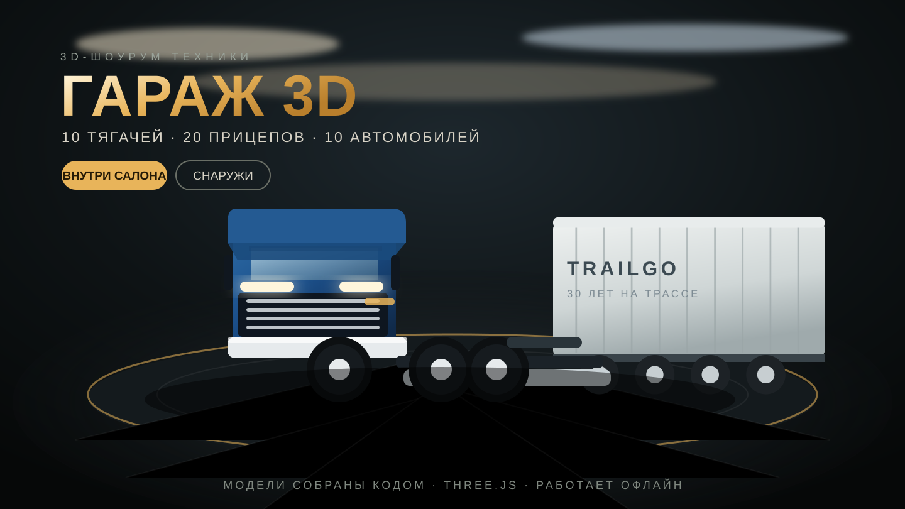

# 🚛 ГАРАЖ 3D — шоурум техники

Интерактивный 3D-шоурум в браузере: **40 экспонатов** — 10 седельных тягачей,
20 типов полуприцепов и 10 автомобилей. Любую модель можно осмотреть снаружи,
**сесть в кабину и осмотреться изнутри**, перекрасить, сравнить с соседней и сфотографировать.

▶️ **Открыть:** [`truck-showroom/index.html`](./index.html) — без установки, сборки и интернета.



## Что внутри

| Категория | Сколько | Что это |
|---|---|---|
| 🚛 Тягачи | **10** | евро-кабина, мега-кабина, капотник 6×4, карьерный 8×4, электромобиль, низкопольный, люкс, городской и регионалка |
| 📦 Прицепы | **20** | шторка, фургон, реф, платформа, трал, цистерна, силос, самосвал, скотовоз, лесовоз, роспуск, контейнер, реф-контейнер, автовоз, B-double, лодочный, стекловоз, ADR, кран-манипулятор, боковой самосвал |
| 🚗 Авто | **10** | седан, универсал, хэтчбек, внедорожник, купе, пикап, фургон, микрокар, кроссовер, спорткар |

### Снаружи и внутри
- **Тягачи:** 3 наружных ракурса (снаружи, борт, сзади) + место водителя, место пассажира
  и спальное место у высоких кабин. Внутри — торпедо с щитком приборов, руль с кнопками,
  рычаг КПП, педали, сиденья с пневмоподвеской, спальник с подушкой и шторками,
  шкаф и холодильник у мега-кабин.
- **Авто:** реальный салон с приборной панелью, экраном, рулём, селектором, подстаканниками,
  задним диваном и ремнями; вид «Место водителя» и «Салон».
- **Прицепы:** только снаружи (4 ракурса) — кабины у них нет, зато есть точки осмотра
  груза: брёвна, катер, стекло, кран, контейнер.

### Кузов, бампер и торпедо автомобилей
Все 10 легковых моделей перебраны после жалобы на дефекты; в `tests/smoke.mjs`
на каждый пункт теперь есть регрессионная проверка:
- **торцы кузова закрыты** — между бортами раньше были открытые панели, и спереди/сзади
  в машину было видно салон; добавлены торцевые «фартуки» из краски;
- **бампер и оптика стоят снаружи** торца, а не утоплены внутрь кузова: решётка, фары,
  поворотники и противотуманки разложены по трём поясам носа;
- **колёсные арки вырезаны в силуэте** — круглые дырки выходили за нижнюю кромку,
  триангуляция рвалась, и над колесом появлялась синяя «перемычка» краски;
- **диск не торчит из покрышки** — ступица, гайки и колпачок утоплены в плоскость диска;
- **планки на борту** идут только между арками и больше не проходят по колёсам;
- **корма в габарите** — у универсала и фургона задняя кромка крыши уходила на 30 см
  за кузов; задние фонари, номер и бампер выставлены по одной линии;
- **торпедо** — приборы, экран и дефлекторы стоят на лицевой стороне панели
  (раньше смотрели в лобовое стекло), моторный щит опущен ниже панели, лобовое стекло
  стало прозрачнее, а глаз водителя больше не упирается в собственную подушку сиденья.

### Один экран, как в 3D-редакторе
Шоурум устроен как вьюпорт Blender: **вся площадь экрана — 3D-сцена**, поверх неё только
кнопки и подписи. Никаких постоянных колонок и списков, которые делят экран.

| Где | Что |
|---|---|
| Сверху | **Каталог**, **Модель**, **Свет**, случайная модель 🎲, скриншот 📷, полный экран ⛶, справка ? |
| Снизу | Категории **тягачи / прицепы / авто** и листание моделей ‹ 1 / 10 › |
| В сцене | название модели, режим (СНАРУЖИ / В КАБИНЕ), чипы видов, столбик камеры справа |
| По кнопке | Каталог выезжает слева, карточка модели — справа. Закрываются по `Esc`, фону или ✕ |

На узких экранах панели превращаются в нижние шторки, а после выбора модели каталог сам
закрывается — сцена снова на весь экран.

### Шоурум
- 4 схемы света: **Студия, Ночь, Выставка, Гараж** (попап «Свет» в верхней панели).
- Осмотр по точкам: «Топливный бак», «Седло», «Горловина люка», «Колесо» и т. п. —
  камера сама подлетает к детали.
- Покраска кузова в 18 цветов (сохраняется за моделью).
- Избранное (двойной клик по названию), поиск по каталогу, сравнение двух моделей рядом.
- Скриншот сцены в PNG одной кнопкой.
- Прогресс (категория, модель, свет, цвета, избранное) хранится в `localStorage`.

## Управление

| Действие | Мышь / клавиатура | Телефон / планшет |
|---|---|---|
| Вращать, приближать, сдвигать | ЛКМ, колесо (к курсору), ПКМ | один палец, два пальца, два пальца |
| Полёт камеры | `W` вперёд, `S` назад, `A` влево, `D` вправо, `Q`/`E` ниже/выше | навпад, свайп |
| Ускорение полёта | `Shift` (в 2,8 раза быстрее) | — |
| Зум | `+` / `−`, колесо, `⌂` на навпаде | щипок, навпад |
| Фокус на детали | клик по детали модели | тап по детали |
| Предыдущая / следующая модель | `←` / `→` | свайп по сцене влево / вправо |
| Сесть в салон / выйти | `I`, двойной клик | двойной тап |
| Вернуть камеру в норму | `Ctrl` (или `Home`, `⌂` на навпаде) | `⌂` на навпаде, щипок |
| Случайная модель | `R` | встряхнуть телефон |

**Свободный полёт** — клавиши `W` `A` `S` `D` двигают камеру относительно взгляда
(вперёд, влево, назад, вправо), `Q`/`E` опускают и поднимают, `Shift` ускоряет,
`Ctrl` мгновенно возвращает камеру в штатную точку текущего вида. Полёт работает
и снаружи, и в салоне.

**Навпад** — это те же движения, что мышью, но кнопками: стрелки вращают камеру,
`+`/`−` приближают, `⌂` возвращает штатный вид. Удержание кнопки крутит непрерывно,
одиночный тап — один шаг. Зум колесом идёт **к курсору**, поэтому приближается
тот узел, на который смотришь, а клик по детали плавно наводит на неё камеру
и подписывает её (например, «Сцепной шкворень» или «Горловина люка»).

| Действие | Мышь / клавиатура |
|---|---|
| Сесть в салон / выйти | `I`, двойной клик по сцене, кнопки «Сесть внутрь» / «Выйти наружу» |
| Свободный взгляд в салоне | зажать ЛКМ и тянуть (или один палец) |
| Виды 1–5 | клавиши `1`…`5` |
| Предыдущая / следующая модель | `←` / `→` |
| Случайная модель | `R` |
| Автовращение / камера в норму | `Пробел` / `Ctrl` (или `Home`) |
| Скриншот PNG | `C` |
| Полный экран | `F` |
| Каталог / карточка модели | кнопки **Каталог** и **Модель** сверху, `Esc` — закрыть |
| Справка | `H`, `Esc` — закрыть |

### Разные устройства
- Телефон, планшет и десктоп определяются автоматически (`src/lib/device.js`):
  классы `is-phone` / `is-tablet` / `is-desktop`, `is-touch`, `is-portrait` / `is-landscape`
  вешаются на `<html>`, а CSS под них меняет размеры целей и раскладку.
- На тач-экранах все кнопки не меньше 40–44 px, hover-эффекты отключены
  (они «залипают» без мыши), подсказки внизу сцены меняются на жесты.
- Каталог и карточка на телефоне открываются шторками снизу на всю ширину,
  в ландшафте — боковыми панелями с уменьшенной шапкой.
- Учитываются «челки» и полоса жестов: `env(safe-area-inset-*)` в шапке, подвале
  и у плавающих кнопок; высота — `100dvh`, чтобы адресная строка Safari не резала сцену.
- Качество рендера подстраивается: на телефоне пиксельное соотношение ≤ 1.35
  и мягкие тени выключены, на мощном десктопе — полное. Если FPS дважды
  подряд падает ниже 30, разрешение автоматически снижается.
- На вертикальном экране угол обзора камеры увеличивается, поэтому модель
  не «распирает» кадр.

### Кузова прицепов
Все 20 прицепов пересобраны — раньше это были белые коробки на раме:
- **контурная маркировка** — красно-белая полоса по бортам и по заднему отбойнику
  (одна геометрия с вершинными цветами, без текстур);
- **ливрея бренда**: у каждого вымышленного перевозчика свой цвет полосы и цветная
  плашка с названием на борту — TRAILGO синий, COLDFLOW бирюзовый, STEELRIDE оранжевый и т. д.;
- **настоящие крылья-арки** над колёсами вместо сплющенных полуцилиндров, брызговики,
  тормозные камеры и пневмоподушки на тележке;
- **юбки** между опорами и тележкой, маркерные огни, задний отбойник с раскосами
  и трёхсекционные фонари на чёрной панели;
- **задние двери** с четырьмя штангами-запорами, петлями и ручками у шторки, фургона
  и рефа; у рефа — холодильная установка с решёткой и вентилятором;
- **цистерна**: три секции с кольцами, эллиптические днища, люки с маховиками,
  настил и ограждение сверху, лестница, шкаф арматуры и сливной патрубок;
- **силосовоз**: два вертикальных бункера с коническим днищем, куполом и лестницей
  на раме с ложементами (раньше это были две «мороженые» воронки);
- **платформа**: ровный пол, коники в карманах, передний щит и груз — рулоны стали
  на деревянных подкладках под ремнями;
- контейнеры получили восемь угловых фитингов, крышу с рёбрами и штанги дверей.

## Технически

- **Three.js r186** + `OrbitControls`, `RoundedBoxGeometry`, `PMREMGenerator`.
- **Все модели строятся кодом** из примитивов: ни одной внешней 3D-модели, текстуры или картинки.
  Тягачи — параметрическая кабина (4 стиля), шасси, баки, седло, колёса с протектором;
  прицепы — общая рама и тележка + 20 разных кузовов; авто — боковины с настоящими проёмами
  окон, верхняя поверхность лофтом, отдельные стёкла, свет и салон.
- Окружение (HDRI-отражения) рисуется на `canvas` и превращается в карту через `PMREMGenerator` —
  поэтому страница работает без CDN и с `file://`.
- Собственный софтверный растеризатор (`tools/render.mjs`) делает PNG-превью моделей в Node —
  без WebGL и браузера; `tools/montage.mjs` собирает контактные листы всех 40 моделей.
- Подключён `../shared/theme.css` — общий дизайн всех игр коллекции (тёмная тема, золотой акцент,
  стеклянные панели, HUD).

### Структура

```
truck-showroom/
├── index.html          интерфейс шоурума
├── style.css           тема на базе shared/theme.css
├── showroom.bundle.js  собранный бандл (esbuild, IIFE — работает с file://)
├── src/
│   ├── app.js           каталог, камера, интерфейс, горячие клавиши
│   ├── stage.js         сцена, свет, пол, подиум, «зал», HDRI
│   ├── data/units.js    каталог: 10 тягачей + 20 прицепов + 10 авто
│   ├── lib/kit.js       материалы, процедурные текстуры, примитивы
│   ├── lib/camera.js    плавные переходы камеры и орбита
│   ├── lib/device.js    определение устройства, жесты, качество рендера
│   └── models/          truck.js · trailer.js · car.js
├── tools/               render.mjs, montage.mjs, serve.mjs
└── tests/
    ├── smoke.mjs        каталог 10/20/10, сборка всех моделей, салоны, геометрия
    └── ui.mjs           интерфейс в jsdom: все 40 моделей, виды, поиск, покраска
```

### Команды

```bash
npm ci                 # three + esbuild + pngjs + jsdom
npm run build          # пересобрать showroom.bundle.js
npm run serve          # локальный сервер (не обязателен: работает и с file://)
npm test               # smoke + интерфейсный тест (96 проверок)
node tests/smoke.mjs   # 40 моделей, 10/20/10, салоны, геометрия
node tests/ui.mjs      # каталог, виды, поиск, избранное, покраска — без браузера
node tools/render.mjs --cat trucks --id atlas-vision --view driver --out preview.png
node tools/montage.mjs --list trailers --view exterior --out sheet.png
```

## Ограничения и честные примечания

- Внешние 3D-модели намеренно **не используются** (в песочнице нет доступа к скачиванию ассетов),
  поэтому вся техника — стилизованная процедурная геометрия, а не фотореалистичные модели.
- Марки, модели и характеристики вымышлены; это самостоятельный шоурум, а не копия реальных брендов.
- Если браузер не даёт WebGL, шоурум не «падает»: остаются каталог, характеристики,
  список видов и покраска, а вместо сцены показывается пояснение, как включить 3D.
- Салоны есть у 10 тягачей и 10 автомобилей. У прицепов салона нет по определению.
