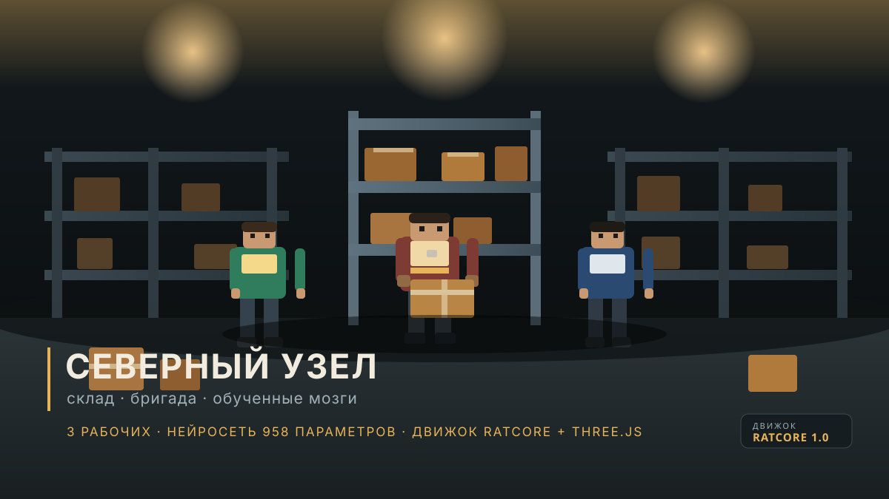

# 🏭 СЕВЕРНЫЙ УЗЕЛ — склад с живыми рабочими (`warehouse-crew`)

3D-симулятор склада, в котором сначала работают **три человека** (бригаду можно расширить до восьми), а не безликие юниты.
У каждого — **обученная нейросеть-мозг** (958 параметров), органы, гормоны,
усталость мышц, зрение, слух и боль. Игрок управляет бригадой **с пульта**:
приказы кнопками, **четыре вида камеры** (включая плоский 2D сверху), разгрузка и
загрузка **фур**, травмы от нарушения техники безопасности и инспектор тела с
**3D-разрезом**.

- ▶️ **Играть:** https://m98978672-boop.github.io/games/warehouse-crew/
- 🌐 **Все игры:** https://m98978672-boop.github.io/games/
- 📥 **Скачать игру, мозги и датасет одним архивом (Dropbox):** [warehouse-crew.zip](https://www.dropbox.com/scl/fi/qfra5c6f0kg75t3nfidc9/warehouse-crew.zip?rlkey=cvvnn7j6stj1oki0l694egyy1&dl=0)
- 📋 **План и возможности:** [`PLAN.md`](./PLAN.md)
- 🧩 **Как устроена игра (шаблон):** [`TEMPLATE.md`](./TEMPLATE.md)



## Что происходит на экране

Склад 26 × 17 м: приёмка с паллетами, три рядовых стеллажа по 12 ячеек
(36 мест хранения), зона отдыха и деспатч. Заказы приходят на приёмку
коробками 5–34 кг — их надо **взять**, **донести** и **уложить** в ячейку.
За каждую доставку — очки; за уроненную или испорченную коробку — штраф.

Рабочие не «ходят по скрипту»: в каждый момент решение принимает их мозг —
`pace, caution, rest, precision, urgency, coop` — шесть чисел, которые сеть
выдаёт по 18 входам тела и склада. Дальше эти числа управляют скоростью,
осторожностью, готовностью идти на перегрузку и помощью товарищам.

## Управление — пульт, а не клавиатура

Левая панель «Пульт управления» — основной инструмент:

| Блок | Что делает |
|---|---|
| **Выбранный рабочий** | вкладки бригады и карточка состояния (изначально Марта, Гриша и Тимур) |
| **Состояние бригады** | предупреждения по игровым показателям, быстрый выбор и инспектор |
| **Приказы рабочему** | Взять · Нести · Перерыв · Ждать · Автономия · Помочь · В туалет · На улицу · Покататься · Уединиться |
| **Приказы бригаде** | Разгрузить приёмку · Все на стеллаж · Общий перерыв · Вся бригада на авто |
| **Вид** | 3-е лицо · сверху за рабочим · весь цех · 2D |
| **Доки и фуры** | вручную вызвать разгрузку или загрузку; свободные ячейки, складские запасы и прогресс рейсов |
| **Магазин** | кнопка «Магазин»: рабочий за 80 очков (до 8 в бригаде), медик за 120 и сторож за 100 |
| **Освещение** | день или ночь — можно переключить в любой момент |
| **Скорость** | 1× · 2× · 4× |
| **Отчёт смены** | снимок результатов склада, бригады и персонала; доступен в любой момент |
| **Контракты смены** | четыре дополнительных задания на доставку и фуры с ограничением времени и наградами |
| **Журнал смены** | последние события и реплики, фильтры предупреждений и успехов |
| **Очередь заказов** | карточки по ближайшему сроку: свободный заказ можно назначить выбранному рабочему или отметить приоритет |

Завершённые погрузки не занимают лимит приёмки; занятый заказ нельзя случайно перехватить у другого рабочего.

Горячие клавиши — только ускорение: `C` — вид, `I` — тело, `Пробел` — пауза,
`T` — 2D, `M` — звук, `S` — сохранить, `F` — полный экран.

## Контракты смены

В пульте можно взять до двух из четырёх контрактов: три укладки за 120 с
(+35 очков), две укладки без падений и порчи за 150 с (+50), две укладки
груза из разгрузочной фуры за 180 с (+55) или две загрузки в фуру за 180 с
(+55). Считаются события после принятия. Для бережного контракта **любое**
падение или порча груза бригадой за время его действия означает провал.
Одна доставка может продвинуть сразу оба активных контракта. Время — игровое:
пауза его останавливает, ускорение ускоряет; срок ограничен концом смены.
Принимать контракт можно, пока до конца остаётся хотя бы 20 секунд. Отмена
освобождает место, но такой контракт уже нельзя взять повторно в этой смене.
Начатые и законченные контракты, прогресс и награды сохраняются, события попадают
в журнал и отчёт (включая JSON). Новая смена сбрасывает доску. Старые снимки v2
без контрактов продолжаются с новой доской.

## Сохранение и продолжение

Смена сохраняется в localStorage этого браузера автоматически каждые 25 секунд
реального времени, при завершении, сворачивании и уходе со страницы (когда браузер
вызывает соответствующие события); кнопка сохранения или
`S` записывают её сразу. При повторном открытии смена продолжается автоматически:
сохраняются бригада и персонал, здоровье и травмы, приказы, мозги, заказы,
стеллажи, фуры, погрузчик, время, пауза и скорость. Динамические грузы и
сегменты упавшего рабочего восстанавливаются в Cannon с положением и скоростями.
Отчёт JSON по-прежнему можно скачать отдельно. Справка содержит кнопку «Новая
смена» с подтверждением; она заменяет сохранённую смену.

Старые сохранения v1 содержали только рекорды и статистику: они читаются без
перезаписи, но из них нельзя восстановить саму смену. При повреждении снимка v2
автозапись блокируется, чтобы не затереть исходные данные; новую смену можно
начать явно через справку. Если браузер запрещает запись или закончилось место,
индикатор сообщает об ошибке. Существующий снимок читается даже при полной
квоте. Если при запуске хранилище нельзя прочитать, запись блокируется до
явного начала новой смены, чтобы не перезаписать возможные данные.
Данные принадлежат браузеру и могут исчезнуть
при очистке его хранилища. Возобновление не гарантирует побитово одинаковое
будущее физики: внутренние контакты решателя и служебные параметры частиц
пересоздаются.

Рабочие учитывают близость свободных напарников при выборе обычных заказов,
при этом срочные грузы остаются приоритетными. Сильная усталость и травмы
заставляют свободного рабочего сначала отдохнуть; при движении он старается
обойти коллег и погрузчик, не проходя сквозь стены. При обмороке
рабочий освобождает назначенный заказ и погрузчик, а груз из рук падает по
физике. Пока он без сознания и восстанавливается, новые приказы на действия
отклоняются; можно включить автономию на потом. После восстановления рабочий
встаёт и вновь может принимать задачи.
Занятая коробкой площадка приёмки не используется для нового груза. Упавшую
или сдвинутую коробку можно назначить работнику, но он дождётся её физической
остановки и подойдёт к её новому положению. Очередь показывает движущийся груз
и ожидание остановки; пока коробка движется, она может столкнуться с окружением.

## Состояние бригады

Сводка в пульте показывает только работников, для которых сработали игровые
пороги: обморок или восстановление после него, здоровье ниже 30 %, энергия ниже
24 %, усталость выше 83 %, травмы, вода ниже 30 % или боль выше 40 %.
При нескольких причинах они собраны в одной карточке; наиболее критичные —
сверху. **«Выбрать»** переключает рабочего, **«Осмотреть»** открывает его
инспектор. Команды на отдых и лечение по-прежнему работают как раньше:
сводка сама не отдаёт приказов и не меняет физиологию или физику. Она
пересчитывается по состоянию рабочих, в том числе после продолжения смены.

## Обзор очереди

В пульте есть фильтры **Все**, **Свободные**, **В работе**, **Приоритет** и
**Срок ≤ 30 с**; последний включает и просроченные активные заказы. Карточки
по-прежнему идут по ближайшему сроку. Сводка показывает свободные ячейки
стеллажей: места, уже зарезервированные для входящих грузов, свободными не
считаются. Также видно, сколько активных заказов близки к сроку или просрочены.
Если совпадений больше 14, кнопка **«Показать ещё»** открывает следующие;
счётчик показывает видимое и общее число. Фильтр влияет только на экран,
не на выбор заказов или физику, и сбрасывается при перезагрузке страницы.

## Приоритет заказов

В карточке свободного заказа нажмите **«В приоритет»**, чтобы отметить его для
бригады. Повторное нажатие снимает метку. В автономном режиме рабочие учитывают
эту отметку при выборе заказа; команда «Взять» без указания карточки тоже её
учитывает. Это предпочтение, а не гарантия: срок, расстояние, состояние рабочих,
доступность погрузчика и ограничения веса по-прежнему важны. Уже назначенный
заказ не переназначается. Изначальная ценность заказа, срок и начисление очков
не меняются. Метка сохраняется при продолжении смены и снимается при завершении,
порче или пропуске заказа; при отправке той же коробки в фуру её можно отметить
заново. На паузе приоритеты можно менять.

## Отчёт смены

Кнопка **«Отчёт смены»** в пульте показывает баланс очков после покупок,
падения, пропущенные и испорченные заказы, работу фур, сведения о текущей
бригаде и нанятом персонале. Доступен переход к инспектору каждого рабочего.
Данные фиксируются при открытии: симуляция не ставится на паузу, кнопку
**«Обновить»** можно нажать для нового снимка. После завершения смены экран
открывается автоматически и доступен повторно из пульта. Экспортируемый JSON
содержит отчёт на момент скачивания, но не является сохранением игры.
Качество учитывает повреждения и опоздание у учитываемых уложенных и
испорченных заказов; если их нет, оно равно 100%.

## Журнал смены

Журнал в пульте доступен и на телефоне. Новые записи идут сверху; фильтр
**«Предупреждения»** показывает предупреждения и проблемы, **«Успехи»** —
положительные события, **«Все»** — также приказы и реплики. Кнопка
**«Показать ещё»** открывает предыдущие записи по 12. Сохраняются последние
80 записей, более старые удаляются из журнала; при новой смене он очищается.
Фильтры влияют только на отображение и сбрасываются при новой смене или
перезагрузке страницы.

## Реплики рабочих

Рабочие отвечают на личные и бригадные приказы, реагируют на доставку, падение
груза и травмы. Свободные коллеги иногда обмениваются короткими фразами, если
они рядом и между ними нет препятствия. Реплики видны над сценой и в журнале;
они не меняют управление, поведение или физику. Время следующего разговора и
незаконченный обмен сохраняются вместе со сменой; старые сохранения совместимы.

В пульте можно включить **озвучку**; по умолчанию она выключена. Используется
только установленный на устройстве локальный русский голос браузера. Если его
нет, останется текст. Озвучка не ставит реплики в очередь и прекращается при
паузе, общем отключении звука, перезапуске и завершении смены. Настройка
озвучки действует до закрытия страницы и не сохраняется между сеансами.

## Ночной свет

В пульте, под выбором камеры, есть переключатель **День / Ночь**. Он не
начинает новую смену и сохраняется вместе с ней. Ночью солнечный свет слабее,
лампы над стеллажами и два уличных фонаря освещают рабочие зоны. В инспекторе
тела показаны зрение и условная освещённость в месте рабочего. При недостатке
света зрение постепенно снижается, особенно у уставших; на свету восстанавливается.
Это влияет на существующую оценку риска уронить груз, а не отключает обученный
мозг. Освещённость физиологии — простая модель расстояния до светильников,
не измерение реальной освещённости из рендера и не трассировка теней.

## Телефон: автомасштаб, шторка и один тап

Интерфейс сам подстраивается под экран — отдельной «мобильной версии» нет:

- **`src/layout.js`** мерит видимую область (`visualViewport`, а не только
  `window.innerHeight`) и выставляет `--ui`: на узком телефоне интерфейс
  ужимается, на крупном — подрастает. От `--ui` считаются все размеры HUD,
  шрифты, отступы и метки над рабочими. Шапка при этом складывается в две
  строки, а вырез экрана и «домашняя полоска» учтены через `env(safe-area-*)`.
- **Пульт = нижняя шторка** с тремя положениями: спрятан (остаётся «язычок»),
  половина экрана, почти весь экран. Тянешь за язычок — шторка едет за пальцем
  и прилипает к ближайшему положению. В ландшафте шторка становится правой
  колонкой: у правого края есть кнопка **«Пульт»**, чтобы открыть её после
  сворачивания; кнопка в заголовке закрывает колонку обратно.
- **Быстрые приказы** — четыре кнопки в один тап (Взять · Нести · Перерыв ·
  Авто) с именем выбранного рабочего; они висят над язычком, пока шторка
  спрятана.
- **Тап по метке** над рабочим выбирает его; **щипок** двумя пальцами
  приближает камеру; **тап по сцене** при открытой шторке возвращает её к
  половине, чтобы видеть склад.
- **Экономия батареи:** на телефоне камера рендерит с пиксельным
  соотношением ≤1,75, без MSAA и с картой теней 512 вместо 1024.
- **Тактильная отдача:** короткая вибрация на приказ, двойная — на уроненную
  коробку (если браузер умеет).

## Анимации

Интерфейс живой, но не мешает: числа очков «докручиваются» до нового
значения, статы подпрыгивают при плюсе, полоска смены тянется по нижней кромке
шапки, шторка едет по кривой, кнопки дают волну от точки нажатия, тосты
выезжают, карточки заказов и рабочие появляются каскадом. В 3D — дыхание
камеры, толчок при уроненной коробке, пульсирующая подсветка под выбранным
рабочим, мерцание ламп, дрейф тактической сетки в виде сверху и вспышка при
смене вида. Всё это уважает `prefers-reduced-motion`: при включённой в системе
настройке анимации отключаются.

## Четыре вида камеры

- **3-е лицо** — камера идёт за выбранным рабочим, плавно доворачивается по
  движению и **не залезает в стеллажи** (проверка препятствий вдоль луча).
- **Сверху за ним** — второй вид сверху: камера висит над выбранным рабочим,
  едет за ним и держит в кадре бригаду. Удобно «смотреть сверху за ними»,
  не теряя, кто где, — при этом не нужно отдаляться на весь цех.
- **Весь цех** — тактический обзор: все три ряда, приёмка, доки с фурами,
  очередь и маркеры рабочих. Идеально для приказов бригаде.
- **2D** — ортографическая карта цеха и улицы; кнопка 2D или `T`. Колесо мыши меняет масштаб.
- Клавиша `C` листает все четыре режима по кругу.

## Коробки, улица и люди

У каждого заказа есть A (откуда приехал груз), B (куда доставить) и C
(текущее положение). Упавшая коробка движется, отскакивает и может лечь
на бок. Тяжёлые заказы 36–62 кг приезжают в отдельную зону: рабочий берёт
их только на погрузчике. Заказы и состояние груза видны в очереди.

Через ворота рабочие выходят на улицу, отдыхают или уединяются. Отдельный туалет с дверью и санитарным оборудованием рассчитан на одного работника; вход и выход проходят через дверной проём. Медик помогает при травмах; сторож замечает катание
на технике. Тяжёлые травмы и истощение могут привести к гибели; в начале
следующего игрового дня бригада пополняется. В карточке показаны нужда,
настроение и здоровье, а движения и напряжение мышц отражают состояние тела.
В магазине можно нанять до пяти дополнительных рабочих за 80 очков каждый (всего до восьми); они получают базовый обученный мозг, принимают приказы и заменяются при необходимости в следующий игровой день.

Пол, двор и картон используют процедурные текстуры RatCore, у пола есть отдельные швы; двор и разметка расположены на разных высотах. У фур и погрузчика вращаются колёса, у погрузчика поднимаются вилы и мигает маячок; рабочие моргают и наклоняются при подъёме и укладке.

Коробки рассчитываются локальным движком Cannon-es: масса, вращение, трение и столкновения с грузами, людьми и окружением; быстрые движения разбиваются на подшаги, но полноценного CCD нет. Незакреплённые коробки переходят в динамический режим от сильного удара; на стеллажах груз остаётся закреплённым. Погрузчик и обычные рабочие управляются навигацией, их кинематические коллайдеры толкают физические грузы (это не симуляция подвески или шин). При обмороке тело становится шарнирным ragdoll из 15 твёрдых сегментов с отдельными кистями и стопами, взаимодействующих с полом, стенами и динамическим грузом; после восстановления физические сегменты удаляются. Обычная ходьба управляется навигацией и анимацией, а кинематическое тело толкает груз. Капли рассчитываются частицами SPH с давлением и вязкостью, при столкновении с окружением и коробками образуют пятна; это ограниченная по числу частиц визуальная модель, а не сплошная жидкость. Движок включён в игру для офлайн-запуска, лицензия — `vendor/CANNON-LICENSE.txt`.

## Фуры: разгрузка и загрузка

У левой и правой стены — доки с воротами. Фура подходит к доку (видно, как она
въезжает), работает и уезжает:

- **Разгрузка:** из фуры выгружаются 3–5 мест, каждое надо донести до ячейки.
- **Загрузка:** наоборот — бригада собирает уже лежащие на стеллажах заказы и
  грузит их в фуру; загруженная коробка освобождает ячейку.
- Фуры приходят автоматически по очереди. В пульте можно выбрать **«На
  разгрузку»** (нужна свободная ячейка) или **«На загрузку»** (нужен груз
  на полке). Занятый док отказывает в вызове; противоположный док может работать
  одновременно. Ручной вызов не меняет порядок автоматических рейсов. Его
  можно сделать и на паузе; после завершения смены — нельзя.
- В пульте блок **«Доки и фуры»** показывает обработанные места и время окна:
  165 секунд симуляции с прибытия, при 30 секундах подсветка предупреждает.
  При паузе таймер останавливается, ускорение влияет на него. Работающие доки
  всегда видны, даже если другой док успел обработать несколько рейсов.
- В карточке работающей фуры раскройте **«Грузы рейса»**: видны привязанные
  к ней коробки, вес и состояние — ожидание, назначение, переноска, укладка,
  погрузка или порча. Учитываются отдельно и места, уже уложенные и переданные
  следующей фуре, и невыполненные места, отправленные обратно на склад. Это
  текущая ведомость, не история: после отъезда список скрывается, поскольку
  груз может перейти к другому рейсу. Раскрытие списка не ставит игру на паузу
  и не назначает задачи бригаде.
- В раскрываемом списке **«Грузы на полках»** показаны фактические остатки,
  а не пустые зарезервированные ячейки. Кнопкой можно отметить или снять
  отметку товара для отгрузки, в том числе на паузе. При ручном и автоматическом
  вызове фуры отмеченные товары выбираются первыми; внутри обеих групп действует
  прежний порядок по ценности. Если отмеченных больше вместимости, остальные
  ждут следующий рейс. Отметка сохраняется в снимке и после возврата груза,
  снимается при фактической погрузке или порче. Она не меняет стоимость, очки
  или приоритет задания бригады и не меняет состав уже прибывшей фуры.
- Фуру можно **отправить досрочно** с подтверждением. Для загрузки оставшийся
  груз возвращают на полку, для разгрузки доставленные к доку коробки остаются
  в работе. Очки за полный рейс при досрочной отправке не начисляются; сам
  отъезд входит в число уехавших рейсов. Подтверждение не меняет паузу: если
  смена идёт, груз и фура могут изменить состояние, пока окно открыто. Если
  фура уже уехала или смена началась заново, команда безопасно отклоняется.
- Если фура уезжает до завершения погрузки, коробка, которую ещё не сняли,
  остаётся на полке; груз в руках или на полу возвращается туда работником,
  без телепортации и награды за доставку. Уже разгруженные места продолжают
  разбирать. При пропуске срока любого обычного, тяжёлого или фурного груза
  через 35 секунд после срока начисляется штраф один раз, но сам груз не
  исчезает: его тоже возвращают на склад без награды за закрытый заказ. До
  этого его ещё можно доставить с обычным штрафом за опоздание. Возврат без срока виден в очереди и
  не считается срочным; зарезервированная ячейка сохраняется до укладки.

## Организм, который реально влияет на работу

Каждый рабочий — это модель тела, а не набор цифр «здоровья»:

- **Органы:** мозг, сердце, лёгкие, печень, желудок, кишечник, почки.
- **Системы:** гормоны (адреналин/кортизол/дофамин), усталость мышц,
  гидратация, голод, кислород, боль, зрение и слух.
- **Связи:** адреналин поднимает `pace` и роняет `precision`; усталость и боль
  режут `caution`; низкий кислород глушит `cognition`; стресс копит кортизол.
- **Обморок:** при энергии ниже 3,5 % рабочий падает и пропускает заказ.
- **Травмы:** мышц (спина, плечо), конечностей (колено, кисть, стопа) и головы.
  Травма — не «минус к здоровью», а следствие нарушения техники безопасности,
  и она меняет поведение (см. ниже). Спина режет переносимый вес, колено —
  скорость (рабочий заметно прихрамывает), кисть — точность хвата и риск
  уронить коробку, голова — скорость решений и внимание.

## Техника безопасности, травмы и досягаемость

- **Коробку берут вплотную.** Точка подхода ставится не дальше вытянутой руки
  (`ARM_REACH` = 1,45 м с учётом габарита): рабочий подходит к паллете или
  ячейке, и только потом хватает коробку. С двух метров, как раньше, не берёт —
  если дотянуться не вышло, он честно отказывается.
- **Предел растяжения мышц.** Суставы рига зажаты анатомическими лимитами
  (`JOINT_LIMITS`): колено не выгибается назад, локоть не ломается в обратную
  сторону, шея и корпус не «резиновые». Плюс жёсткий лимит на подъём:
  безопасный вес = 85 % предела, минус травмы.
- **Правила склада** (видны в инспекторе `I`): тяжесть — вдвоём, с грузом —
  шагом, не разворачиваться резко, устал — передохни, хват корпусом, береги
  голову. Нарушение правила = реальный риск травмы, а не абстрактный штраф.
- **После травмы рабочий осторожнее:** растёт «страх» (`fear`), падают `pace`
  и лимит подъёма, растёт `caution`. Испуганный рабочий больше не бежит с
  коробкой и отказывается от веса выше безопасного — правила соблюдаются сами,
  без приказов.

**Инспектор тела** (`I` или ♥ в шапке) показывает живой 3D-разрез: корпус
раскрывается, видно пульсирующее сердце, дышащие лёгкие, перистальтику
кишечника и подсветку органов по состоянию. Модель можно вращать мышью.

## Мозги: обученная сеть в файлах игры

| Файл | Что внутри |
|---|---|
| `src/ai/brain-net.js` | сеть 18 → 24 → 16 → 6, **958 параметров**, чистый JS |
| `data/brain_weights.json` | базовые веса после обучения |
| `data/brains/{marta,grisha,timur}.json` | личные мозги (веса + характер) |
| `data/brain_dataset.json` | датасет 240 наблюдений «ситуация → хорошее действие» |
| `data/brain_training_log.json` | история обучения (эпохи, ошибка, прирост счёта) |
| `training/train-brain.mjs` | сам тренер, запускается локально без зависимостей |

Обучение — эволюционное (CMA-подобная мутация + отбор по счёту на прогонах
склада), всё на чистом Node.js, без внешних библиотек:

```sh
node training/train-brain.mjs            # переобучить базовый мозг
node tests/brain.test.mjs                # проверить, что обученная политика лучше случайной
```

Контрольные цифры (последнее обучение, 30 поколений × 18 особей):
**необученная политика 353,4 очка в среднем**, **базовая обученная — 388,6**,
Марта 400,2, Тимур 397,1, Гриша 461,1 (он аккуратный «тихоход» и меньше роняет).
Тестовая смена трёх рабочих: **72 доставки за 4 минуты, 0 испорченных заказов**.

## Модели и коробки: как они стоят

Примитивы движка растут **от y = 0 вверх**, поэтому и коробка, и полка ставятся
по своему низу, а не по центру. Размеры коробки берутся из геометрии
(`geometry.boundingBox`), а высота опоры — из сцены: пол 0, паллета приёмки
0,12, площадка дока 0,09, полка `slot.h + 0,025`. Из-за этого коробка больше не
висит в воздухе на фиксированных 0,13 м и не тонет в полке.

Несомую коробку рабочий держит на животе: она — ребёнок `carryAnchor`, а углы
плеча и локтя считает двухзвенная обратная кинематика под размер коробки, так
что кисти лежат на её бортах. Когда коробку кладут на полку, она **возвращается
в сцену** — раньше она оставалась ребёнком рабочего и улетала вместе с ним.
Это сторожат тесты `tests/boot-jsdom.mjs`: 30 тысяч замеров «низ коробки против
опоры» и «далеко ли коробка от несущего».

Для проверки настоящего WebGL можно установить `playwright-core`, запустить из
корня репозитория `python3 -m http.server 8765` и выполнить:

```sh
WC_BROWSER_EXECUTABLE=/путь/к/chromium WC_BROWSER_URL=http://127.0.0.1:8765 node warehouse-crew/tests/browser-webgl.mjs
WC_BROWSER_VIEW=portrait WC_BROWSER_EXECUTABLE=/путь/к/chromium WC_BROWSER_URL=http://127.0.0.1:8765 node warehouse-crew/tests/browser-webgl.mjs
```

Тест проверяет WebGL, материалы рук, очередь и компоновку в двух ориентациях;
он использует программный рендер и не заменяет проверку на конкретном телефоне.

## Движок: RatCore — главный, Three.js — рисующий

По правилам репозитория **вся геометрия и вся логика идут через RatCore**,
а Three.js только рисует то, что отдал движок:

1. `src/render/meshes.js` описывает модели **рецептами** (`box`, `cylinder`,
   `sphere`) и собирает их через `engine.tools.build.fromRecipe`.
2. Готовый меш забирается мостом `engine.tools.bridge.exportMesh` →
   `{positions, normals, colors, index, bounds}`.
3. Буферы кладутся в контейнер `new THREE.PlaneGeometry(1, 1)` — так требует
   Барьер 4 аудитора RatCore (ручная геометрия и прямые вызовы `gl.*` запрещены).
4. Сеть, ГПСЧ и часы тоже из ядра: `RatCore.tools.*`, без обращений к `Math.random`.

Около 300 мешей и **7 000 треугольников** на всю сцену — включая 36 ячеек,
3 стеллажа, паллеты, фуры, коробки со скотчем и ярлыками и трёх человек
(51 деталь на рабочего: каска с полями и ободом, лицо, воротник, жилет с двумя
светоотражающими полосами, карман и бейдж, ремень с пряжкой, суставы-шарики в
плечах, локтях, бёдрах, коленях и стопах, перчатки с большим пальцем, ботинки
с подошвой).

## Файлы

```
warehouse-crew/
├── index.html            HUD и подключение движка (без CDN, всё локально)
├── style.css             @import ../shared/theme.css + стили пульта
├── cover.svg             обложка
├── src/
│   ├── config.js         палитры рабочих, камеры, тайминги смены
│   ├── util.js           математика, форматирование, clamp
│   ├── save.js           сохранение прогресса (localStorage)
│   ├── audio.js          звук без файлов (WebAudio)
│   ├── ai/brain-net.js   нейросеть-мозг 958 параметров
│   ├── sim/model.js      тело: органы, гормоны, мышцы, чувства
│   ├── sim/warehouse.js  склад, заказы, A*-маршруты, ячейки
│   ├── sim/worker.js     рабочий: восприятие → мозг → действие
│   ├── render/meshes.js  рецепты моделей + мост exportMesh
│   ├── render/world.js   сцена, камеры, анимация бригады
│   ├── render/bodyview.js 3D-разрез тела в инспекторе
│   ├── game.js           симуляция, приказы, смена, статистика
│   ├── render.js         цикл отрисовки
│   ├── ui.js             пульт, карточки, модалки, инспектор
│   └── main.js           загрузка данных, boot
├── data/                 мозги, датасет, лог обучения
├── training/             тренер сети
├── tools/crew-shot.mjs   кадр рабочего в PNG без браузера
├── tests/                смоук и тест мозга
└── screenshots/          вид от третьего лица, сверху, портрет, разрез
```

## Архив с игрой и мозгами

В архиве `warehouse-crew.zip` лежит всё сразу: готовая HTML-игра (`warehouse-crew/`),
веса и личные мозги (`data/`), датасет и лог обучения, тренер, тесты и скриншоты,
плюс локальные библиотеки (`shared/`, `shooter/three.min.js`, `ratcore/ratcore.bundle.js`).

1. Распаковать архив целиком (не перетаскивать один `index.html`).
2. Открыть `warehouse-crew/index.html` — работает офлайн и с `file://`.
3. В корне архива `START-HERE.txt` — короткая инструкция по запуску и управлению.

## Если игра не запускается

1. **Открывайте `warehouse-crew/index.html`, а не отдельный файл из архива** —
   рядом должны лежать `shared/`, `shooter/` и `ratcore/` (в архиве с Dropbox они есть).
2. **Мозги уже в коде.** `data/brain-data.js` — те же веса, что в `data/brain_weights.json`,
   поэтому игра стартует и с диска (`file://`), где браузеры режут `fetch()` на локальных JSON.
   Если данные всё-таки недоступны, включается запасной синтетический мозг — смена начнётся в любом случае.
3. **Совсем не открывается — поднимите сервер** из корня распакованного архива:
   `python3 -m http.server 8000` → `http://localhost:8000/warehouse-crew/`.
4. **Чёрный экран и сообщение про WebGL** — включите аппаратное ускорение в браузере
   или откройте в Chrome/Edge/Firefox.

Пересобрать мозги «в коде» после переобучения: `node tools/embed-brains.mjs`.

## Тесты

```sh
node tests/smoke.mjs    # структура игры, синтаксис, HUD, локальные ресурсы
node tests/brain.test.mjs  # обученная сеть > необученной, датасет на месте
node tests/mechanics.test.mjs  # досягаемость, фуры, травмы, отказ от тяжёлого
node tests/features.test.mjs   # физика груза, техника, улица и нужды
node tests/physics.test.mjs    # масса, столкновения и вращение грузов
node tests/checkpoint.test.mjs # перезагрузка, физика и повреждённые сохранения
node tests/lighting.test.mjs   # ночное освещение, зрение и восстановление
node tests/boot-jsdom.mjs      # запуск, сцена и интерфейс (нужны jsdom+three)
node tools/crew-shot.mjs     # кадр рабочего в PNG без браузера (нужны jsdom+three)
```

## Скриншоты

| Вид | Файл |
|---|---|
| От третьего лица (рабочий с коробкой) | `screenshots/stage-third.png` |
| Тактический сверху | `screenshots/stage-top.png` |
| Рабочий крупным планом (в цеху) | `screenshots/stage-portrait.png` |
| Три персонажа в ряд | `screenshots/rig-lineup.png` |
| 3D-разрез тела | `screenshots/stage-body.png` |

---

Сделано на движке **RatCore 1.0.0** + **Three.js r186**. Библиотеки лежат
локально в репозитории — игра работает офлайн и с `file://`.
